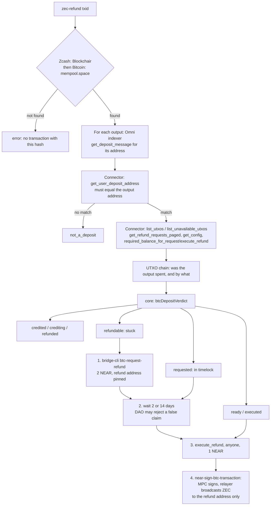

# Architecture

Four modules and no runtime dependencies.

| File | Role |
|---|---|
| `src/core/btc-refund.ts` | Pure logic: the connector accounts, `btcDepositVerdict`, `refundSteps`, `refundBoard`, `receiverOf`. No I/O, no clock (the current time is passed in). |
| `src/btc-refund.ts` | I/O. `publicBtcRefundClient(fetch, rpc, chain)` reads Blockchair (Zcash) or mempool.space (Bitcoin), the Omni bridge indexer and the connector's view methods over NEAR RPC. `checkBtcDeposit` collects the facts and asks the core for a verdict; `checkRefundBoard` builds the board. |
| `src/render-btc-refund.ts` | Plain-text report and board. |
| `src/cli.ts` | `zec-refund <txid> [--vout N] [--json]`, `zec-refund --board`. |

## Flow

## Trust boundaries

- The **indexer** is only a lookup. Its deposit message is used only after the connector derives the same deposit
  address from it.
- The **connector contract** decides everything that matters: whether the coin was credited, the timelocks, and
  where the refund goes.
- **Blockchair and mempool.space** supply the transaction, its senders and whether the output was spent. A refund is
  recognised only when the spend uses that one coin and pays only the refund address.
- The tool holds no key. Signing happens outside it, by the user (NEAR transactions) and by NEAR's MPC network (the
  Zcash refund transaction).

## Testing

`src/**/*.test.ts` replays payloads recorded on 2026-10-13 from the real endpoints (`src/fixtures/btc-refund/`) through
an injected `fetch`. Any request that was not recorded fails the test. `src/btc-refund.live.test.ts` runs the same
checks against the live endpoints, on demand.
