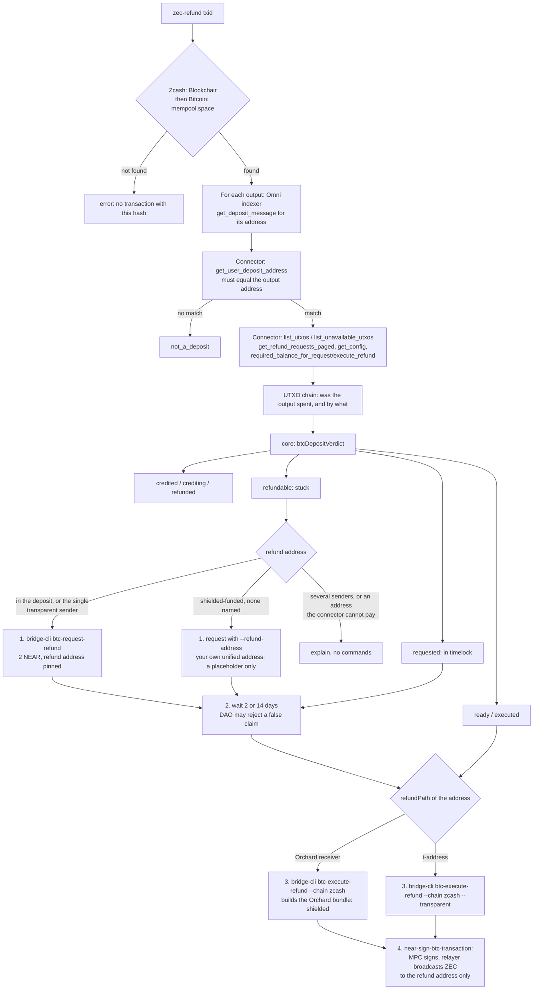

# Architecture

Five modules and no runtime dependencies.

| File | Role |
|---|---|
| `src/core/btc-refund.ts` | Pure logic: the connector accounts, `btcDepositVerdict`, `refundSteps`, `refundBoard`, `receiverOf`; the Zcash refund fee (`zip317Fee`, `ZCASH_REFUND_FEE_ZAT`, `refundFeeFor`) and `refundPath` (which `execute_refund` an address can take: `shielded`, `transparent` or `none`). No I/O, no clock (the current time is passed in). |
| `src/core/zcash-address.ts` | Pure Zcash address parsing with no dependencies: Base58Check (own SHA-256), Bech32/Bech32m, ZIP-316 unified addresses (F4Jumble with own BLAKE2b, typecode items), and `classifyZcashAddress`: kind, receivers, and which refund the connector can build to it. |
| `src/btc-refund.ts` | I/O. `publicBtcRefundClient(fetch, rpc, chain)` reads Blockchair (Zcash: the transaction dashboard, and for the deposit the node's decoded transaction for the shielded pools that funded it) or mempool.space (Bitcoin), the Omni bridge indexer and the connector's view methods over NEAR RPC. `checkBtcDeposit` collects the facts and asks the core for a verdict; `checkRefundBoard` builds the board. |
| `src/render-btc-refund.ts` | Plain-text report and board. |
| `src/cli.ts` | `zec-refund <txid> [--vout N] [--json]`, `zec-refund --board`. |

## Flow

## Trust boundaries

- The **indexer** is only a lookup. Its deposit message is used only after the connector derives the same deposit
  address from it.
- The **connector contract** decides everything that matters: whether the coin was credited, the timelocks, and
  where the refund goes.
- **Blockchair and mempool.space** supply the transaction, its senders, the shielded pools that funded it and whether
  the output was spent. A refund is
  recognised only when the spend uses that one coin and pays only the refund address.
- The tool holds no key. Signing happens outside it, by the user (NEAR transactions) and by NEAR's MPC network (the
  Zcash refund transaction).

## Zcash refund rules (from the deployed source)

Read from Near-One/btc-bridge `btc-bridge-v0.9.7-rc3` (`d2140ec`), whose release wasm has the deployed code hash.

- `request_refund` stores `gas_fee`: on Zcash `get_refund_gas_fee()` = max(ZIP-317 fee of a 1-input/1-P2PKH-output
  transparent refund, ZIP-317 fee of a 1-input/1-action shielded refund) = 10,000 zatoshis. Only the DAO or operator may
  pass a custom fee. The request is refused unless `gas_fee < amount`.
- `execute_refund(utxo_storage_key, chain_specific_data)`: without `chain_specific_data` it builds one transparent
  output, which needs a scriptPubKey (t-address, TEX, or a unified address's P2PKH/P2SH receiver). With an Orchard
  bundle it builds no transparent output; `validate_orchard_bundle` checks the bundle pays the unified address's
  Orchard receiver, and the contract checks the amount equals `amount - gas_fee`. Since NU6.3 the bundle goes in the
  v6 transaction's Ironwood slot.
- The address parser has no Sapling or Sprout conversion, so those addresses can never be paid; `request_refund` does
  not check the address.

## Testing

`src/**/*.test.ts` replays payloads recorded on 2026-10-13 from the real endpoints (`src/fixtures/btc-refund/`) through
an injected `fetch`. Any request that was not recorded fails the test. The two Blockchair raw-transaction payloads are
trimmed (hex, proofs, signatures and ciphertexts removed). Cases with no real example on mainnet (a stuck
shielded-funded deposit, a Sapling refund address) are built from real data with one field changed and say
"synthetic" in the test name. `src/core/zcash-address.test.ts` runs the ZIP-316 F4Jumble and unified-address vectors
from zcash/zcash-test-vectors (`src/fixtures/zip316/vectors.json`, a subset). `src/btc-refund.live.test.ts` runs the same
checks against the live endpoints, on demand.
